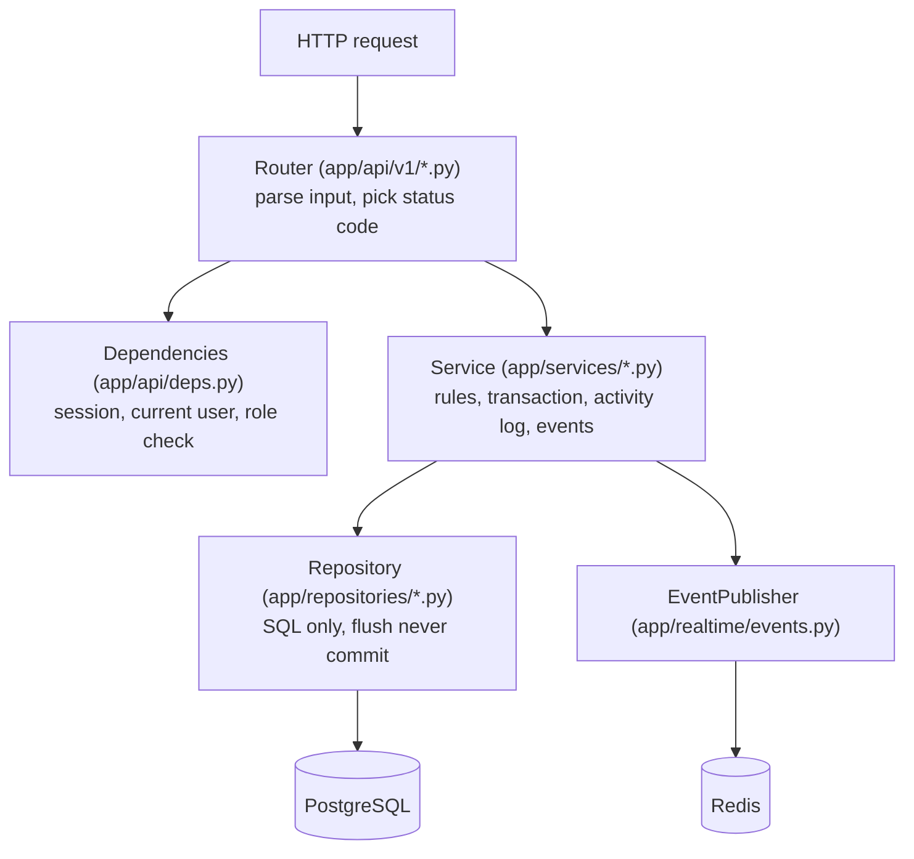
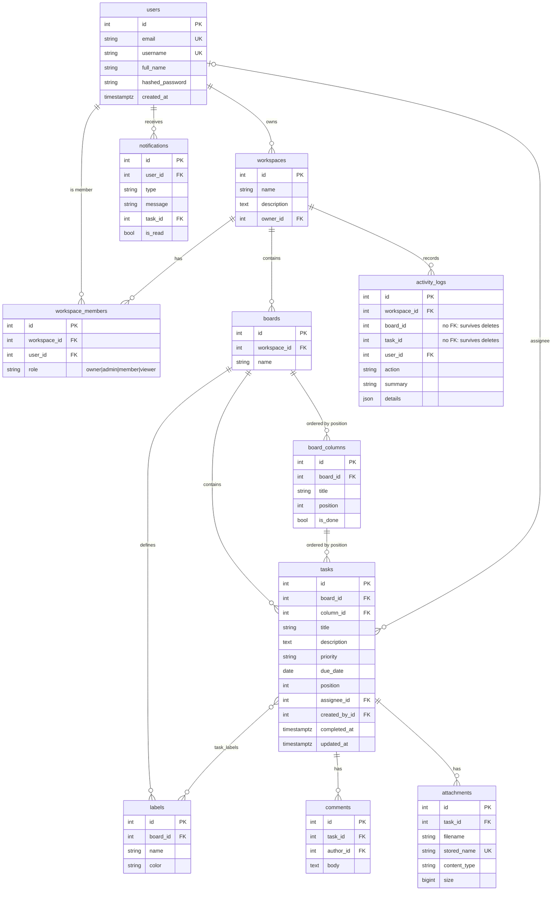
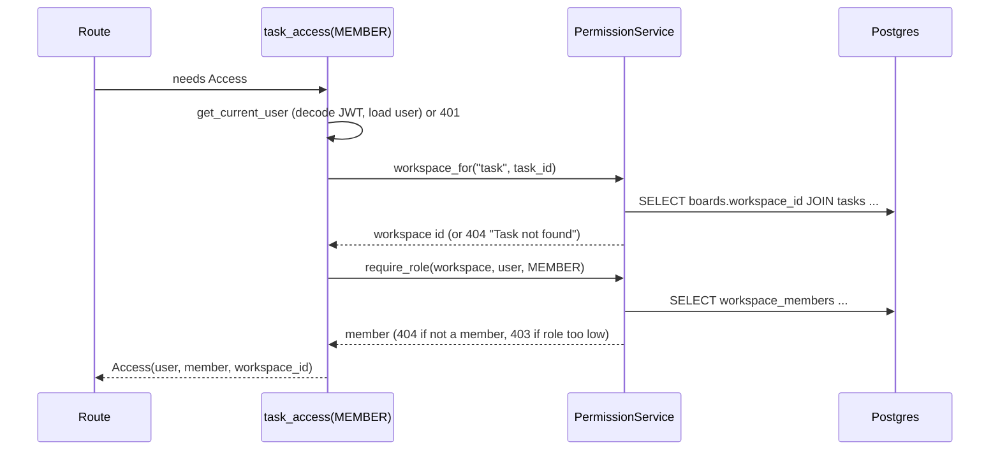
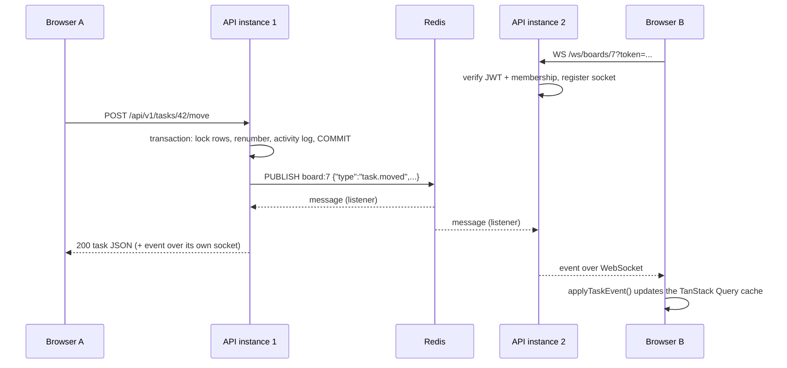

# Flowboard Architecture

This document explains *how the pieces fit*. For a guided tour of the code, read
[`LEARNING_GUIDE.md`](LEARNING_GUIDE.md).

## 1. Containers

| Service | Image | Role |
|---|---|---|
| `db` | `postgres:16-alpine` | All persistent data |
| `redis` | `redis:7-alpine` | Pub/sub channel per board, login rate-limit counters |
| `api` | `backend/Dockerfile` | FastAPI (uvicorn). Runs migrations + seed on start |
| `web` | `frontend/Dockerfile` | nginx: serves the built React app, proxies `/api`, `/ws`, `/docs` to `api` |

In development without Docker, Vite plays nginx's role (see `frontend/vite.config.ts`).
Either way the browser talks to **one origin**, so cookies/CORS stay simple.

## 2. Backend layers

Rules that keep the layers honest:

1. **Routers never touch the database.** They call a service and wrap the result in a schema.
2. **Services own the transaction.** Repositories only `flush()` (send SQL, get ids); the service
   calls `commit()` once, so a task move and its activity-log row are saved together or not at all.
3. **Events are published after the commit.** A browser never hears about a change that was
   rolled back.
4. **Schemas in, schemas out.** Request bodies are Pydantic models; responses are built with
   `XOut.model_validate(orm_object)`. ORM objects and password hashes never leave the API.
5. **One error shape.** Services raise `AppError` subclasses (`app/core/errors.py`); handlers turn
   them into `{"detail", "code"}` with the right status.

## 3. Data model

Design notes:

- **`tasks.board_id` is denormalised** (it could be derived from the column). It makes the most
  common queries (list/filter tasks of a board, find a task's workspace for permission checks)
  a single join shorter.
- **Enums are stored as VARCHAR + CHECK** (`native_enum=False`). Adding a role or priority later
  is a simple migration; Postgres `ENUM` types are awkward to change.
- **Index `(column_id, position)`** matches how tasks are always read: per column, in order.
- **No unique constraint on `(column_id, position)`**: while renumbering, two rows briefly share a
  position inside the transaction. The service guarantees 0..n-1 at commit time instead (and the
  tests check it).
- **Activity logs keep plain `board_id` / `task_id` integers** so history is not cascade-deleted
  with the task it describes.
- All foreign keys have explicit `ON DELETE` rules: deleting a workspace removes everything in it;
  deleting a user keeps their tasks/comments (`SET NULL`).

## 4. Authorization (RBAC)

Roles are ranked `viewer < member < admin < owner` (`app/models/enums.py`). Each route declares the
minimum role with a dependency, for example `Depends(task_access(Role.MEMBER))`:

| Action | Viewer | Member | Admin | Owner |
|---|:-:|:-:|:-:|:-:|
| Read workspace, boards, tasks, comments, activity, analytics | ✓ | ✓ | ✓ | ✓ |
| Create/edit/move/delete tasks, comment, upload, create labels | | ✓ | ✓ | ✓ |
| Delete other people's comments | | | ✓ | ✓ |
| Create/edit/delete boards, columns, labels; rename workspace | | | ✓ | ✓ |
| Invite/remove members and viewers | | | ✓ | ✓ |
| Add/remove/promote admins, delete the workspace | | | | ✓ |

## 5. Real-time events

Event types: `task.created|updated|moved|deleted`, `comment.created|deleted`,
`attachment.created|deleted`, `column.created|updated|deleted`, `label.created|deleted`,
`board.updated|deleted`. Each message is `{"type", "board_id", "actor_id", "data"}`; for task
events `data` has the same shape as the REST `TaskOut` response.

WebSocket close codes: `4401` bad/expired token (the client refreshes and reconnects),
`4404` not a member or no such board (the client gives up).

## 6. Ordering strategy

Columns on a board and tasks in a column use **dense integer positions** (always `0..n-1`).
Moving = take the list, remove the item, insert it at the new index, rewrite positions that
changed (`app/services/ordering.py`). Concurrency is handled with `SELECT … FOR UPDATE` on the
affected columns' tasks, locking columns in ascending id order to avoid deadlocks.

Trade-off: a move touches up to *n* rows. That is cheap for Kanban columns. Apps with huge
ordered lists use *fractional* or *lexicographic* positions (insert at `(a+b)/2`, rebalance
rarely); see the learning guide for a comparison and an exercise.

## 7. Frontend data flow

- **Server state** (workspaces, boards, tasks, comments…) lives in the TanStack Query cache.
  Keys are defined in `src/lib/queryKeys.ts`.
- **Mutations** either update the cache directly (`setQueryData`, e.g. optimistic drag) or
  invalidate keys so they refetch.
- **WebSocket events** (`src/hooks/useBoardSocket.ts`) patch the unfiltered task list with the
  pure function `applyTaskEvent` and invalidate filtered lists, comments or the board.
- **Auth**: tokens in `localStorage`; the axios response interceptor refreshes once on 401 and
  retries (`src/api/client.ts`).

## 8. Logging and health

- One JSON log line per request (`request_id`, method, path, status, duration) from the middleware
  in `app/main.py`; the request id is echoed in the `x-request-id` header.
- `GET /health` checks the database and Redis and returns 503 if either is down; Docker Compose
  uses it (`scripts/healthcheck.py`) to start `web` only after `api` is healthy.
